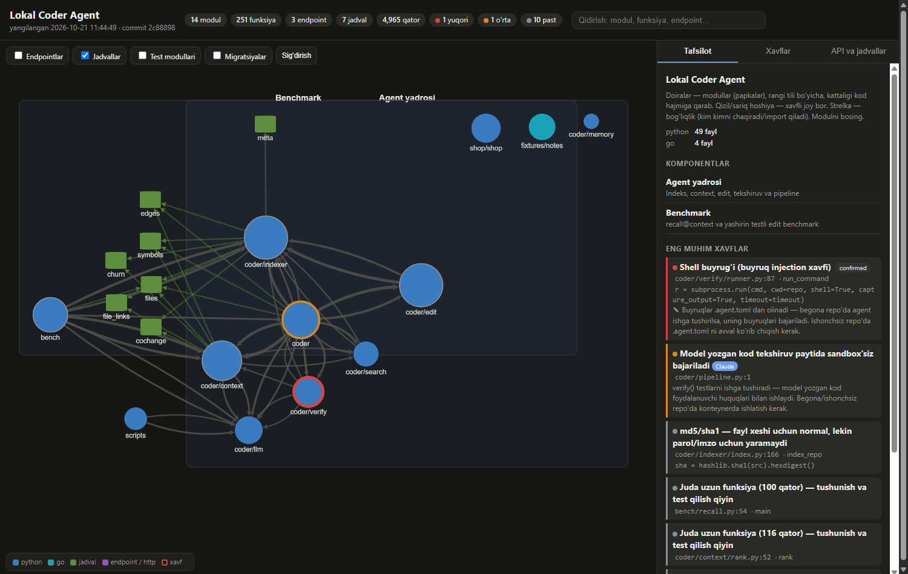

# loyiha-xotirasi

[Claude Code](https://claude.com/claude-code) uchun plugin: har bir loyihada **kod arxitekturasi**, **ish jurnali** va **interaktiv kod xaritasini** repo ichida yuritadi. Bir necha kundan keyin qaytsangiz ham — siz ham, Claude ham, boshqa AI ham — loyihani bir qarashda tushunadi: qism qaysi qism bilan bog'langan, qaysi funksiya qayerdan chaqiriladi, qayerda zaif joy bor, nima qilindi va nima qoldi.



## Nimalar yaratiladi (`docs/`)

| Fayl | Kim uchun | Nima |
|---|---|---|
| `ARCHITECTURE.html` | odam | Brauzerda ochiladigan interaktiv graf: modullar va ularning bog'lanishlari, funksiyalar grafigi, HTTP endpointlar, DB jadvallari, **zaif joylar** (qizil/sariq), qidiruv |
| `architecture.json` | AI | Xuddi shu ma'lumot bitta JSON'da: modullar, funksiyalar (kim kimni chaqiradi), endpointlar → handler, jadvallar → ishlatuvchilar, xavflar |
| `architecture.notes.json` | Claude yozadi | Modul/funksiya izohlari, komponentlar, xavflarni ko'rib chiqish (haqiqiy / yolg'on signal), Claude topgan zaif joylar |
| `ARCHITECTURE.md` | hamma | Tuzilish, qarorlar va sabablari, tasdiqlangan zaif joylar |
| `PROGRESS.md` | hamma | Hozirgi holat, keyingi qadamlar, funksiyalar holati (✅ 🟡 ⬜ ⛔), sanali o'zgarishlar jurnali |

## Qanday ishlaydi

1. **Skaner** (`scripts/scan.py`, faqat Python standart kutubxonasi) kodni o'qiydi: Python — `ast` bilan aniq; Go, TypeScript/JavaScript, Dart — regex bilan.
   Topadi: modullar, funksiyalar va chaqiruvlar, importlar, HTTP marshrutlar (FastAPI/Flask, Django, Go net/http/chi/gin, Express, Next.js) va ularning handlerlari, frontend → endpoint chaqiruvlari, DB jadvallari (SQL, sqlc, Django/SQLAlchemy modellari).
   Xavf signallari: SQL injection (formatlangan SQL), `eval`/`exec`, shell buyruqlari, kodda yozilgan parol/kalit, TLS o'chirilgan, xavfli deserializatsiya, XSS, debug/CORS sozlamalari, yutib yuborilgan xatolar, juda uzun funksiyalar, ko'p joydan chaqiriladigan "issiq nuqtalar", testsiz modullar.
2. **Claude** avtomatik signallarni kodni o'qib tekshiradi (`confirmed` / `ok` sababi bilan / `fixed`), skaner ko'ra olmaydigan zaif joylarni (avtorizatsiya, validatsiya, IDOR …) qo'shadi, modullarga izoh yozadi.
3. **Hook'lar:** sessiya boshida `PROGRESS.md` Claude'ga ko'rsatiladi; kod o'zgarib, jurnal yangilanmagan bo'lsa Claude ishni tugatishdan oldin bir marta eslatiladi.

## O'rnatish

Claude Code ichida:

```
/plugin marketplace add Muhammadalixon-Qodirov/loyiha-xotirasi
/plugin install loyiha-xotirasi@loyiha-xotirasi
```

Talablar: `python` (3.9+), `git`, `bash` (Windows'da Git Bash). Grafik kutubxonasi (Cytoscape.js) brauzerda CDN'dan yuklanadi.

## Ishlatish

- *"loyiha xotirasini boshla"* yoki `/loyiha-xotirasi` — hujjatlar va xarita yaratiladi.
- *"kod xaritasini yangila"*, *"zaif joylar qayerda?"* — skaner + Claude ko'rib chiqishi.
- *"qayerda to'xtadik?"* — `PROGRESS.md` asosida javob.
- Skanerni qo'lda: `python skills/loyiha-xotirasi/scripts/scan.py <repo>` → `docs/ARCHITECTURE.html` ni brauzerda oching.

Avtomatik xavf signallari — taxmin; yakuniy hukmni kodni o'qigan Claude (yoki siz) beradi. Hujjatlar siz gaplashgan tilda yoziladi.
