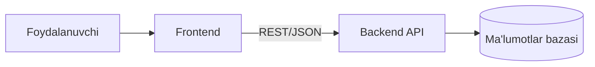
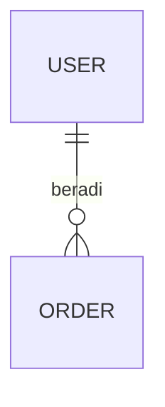

# Arxitektura — <Loyiha nomi>

> Oxirgi yangilanish: YYYY-MM-DD. Holat va jurnal: [PROGRESS.md](PROGRESS.md)

## 1. Loyiha nima qiladi

<2–4 gap: kim uchun, qanday muammoni hal qiladi, asosiy foydalanish ssenariysi.>

## 2. Umumiy ko'rinish



| Qism | Texnologiya | Joyi |
|---|---|---|
| Frontend | | `frontend/` |
| Backend | | `backend/` |
| Ma'lumotlar bazasi | | |
| Deploy | | |

## 3. Papkalar va modullar

| Papka / paket | Vazifasi | Asosiy fayllar |
|---|---|---|
| | | |

## 4. Ma'lumotlar modeli



<Asosiy jadvallar/modellar, muhim maydonlar va cheklovlar.>

## 5. Asosiy oqimlar

<Eng muhim 2–3 ssenariy: so'rov qayerdan kirib, qaysi qatlamlardan o'tib, qayerga yoziladi. Murakkab bo'lsa — sequenceDiagram.>

## 6. Tashqi bog'liqliklar va konfiguratsiya

| Nima | Nima uchun | Sozlama (maxfiy qiymat EMAS, faqat nomi) |
|---|---|---|
| | | `.env`: `...` |

## 7. Ishga tushirish, test, deploy

```bash
# lokal ishga tushirish
# testlar
# deploy
```

## 8. Qarorlar (ADR)

Yozuvlar o'chirilmaydi; eskirsa "bekor qilindi" deb belgilanadi.

| Sana | Qaror | Muqobillar | Nega |
|---|---|---|---|
| YYYY-MM-DD | | | |

## 9. Yangi modul / funksiya qo'shish retsepti

<Shu loyihada yangi endpoint/sahifa/modul qo'shishda qaysi fayllarga tegiladi, qaysi tartibda, qaysi test yoziladi.>
